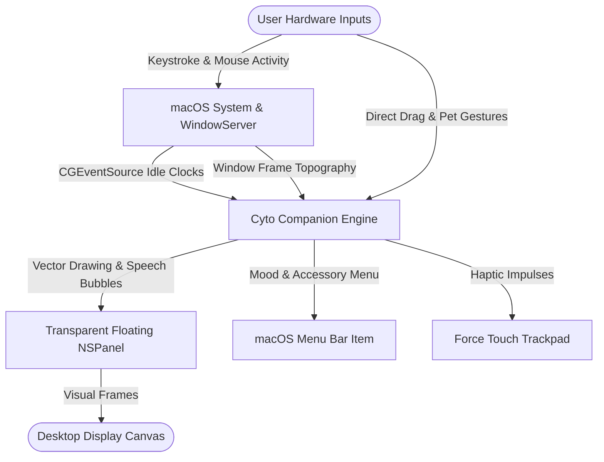
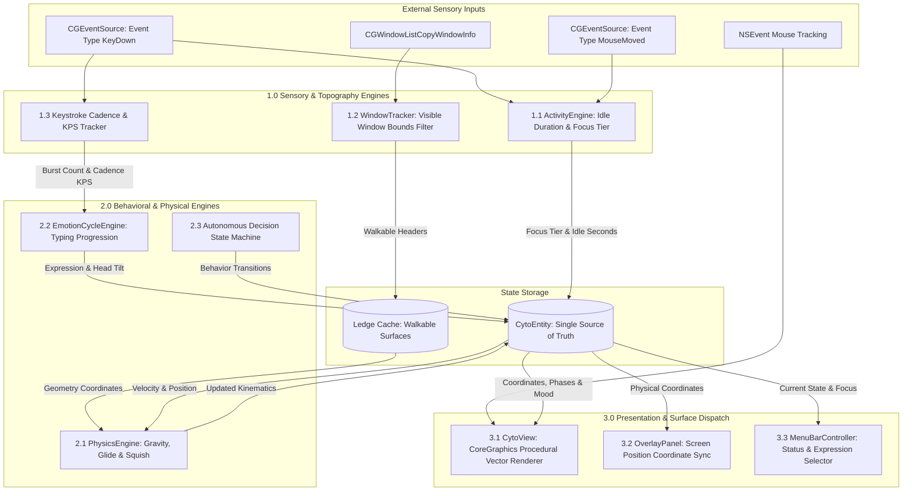
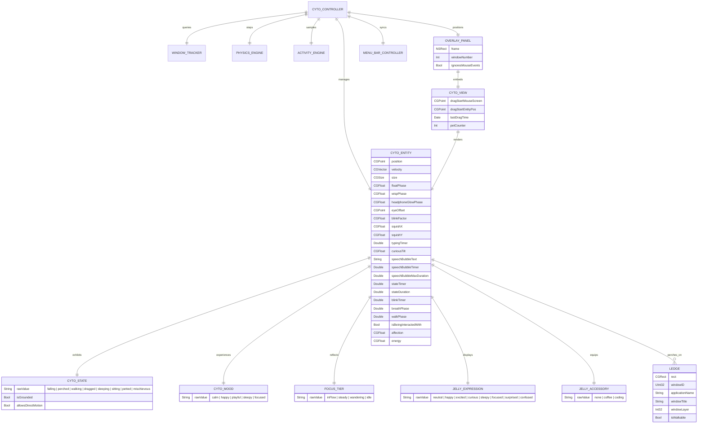
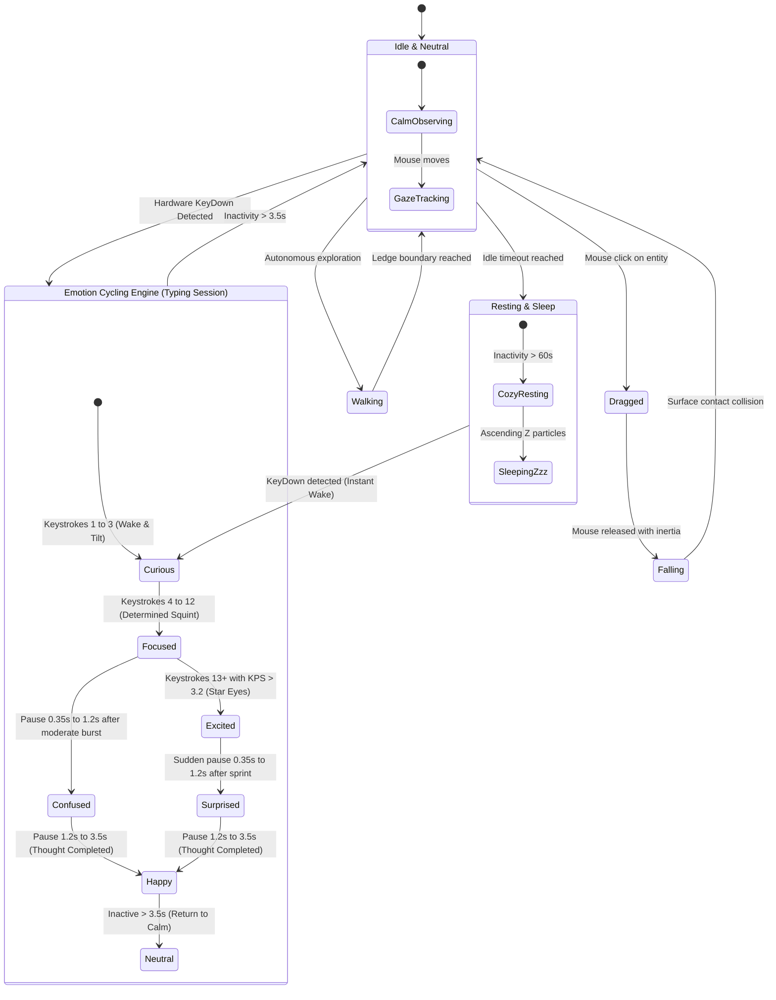

# Cyto


Cyto is an offline, native macOS desktop companion and ambient lifeform designed to introduce organic physical behavior, spatial awareness, and real-time focus dynamics directly onto the operating system canvas.

Unlike standard utilities or static status bar apps, Cyto operates as a living digital entity suspended in user-space. It interacts directly with the spatial boundaries of open application windows, dynamically adjusting its behavioral states, physical movements, and energy levels according to user workflow cadence and system idle metrics.

## Concept and Philosophy

Cyto is engineered to bridge sensory interaction, procedural physics, and non-intrusive ambient companionship on Apple Silicon hardware without requiring network connectivity, telemetry, or invasive permissions.

- Spatial Topography: Window title bars, IDE headers, and browser frames serve as physical surfaces and walkable ledges.
- Dynamic Cadence: Real-time hardware typing frequency and mouse gaze tracking influence emotional states and energy levels.
- Non-Invasive Integration: Dedicated compact floating surface (`NSPanel`) with circular hit-testing allows uninterrupted click-through to background applications.

---

## Architecture Overview

Cyto utilizes a decoupled modular architecture executed on a high-precision 60Hz display link timer. The system orchestrates low-overhead window tracking, zero-permission hardware telemetry, ethereal kinematics, an emotion cycling state machine, and a vector rendering pipeline.

```
+-----------------------------------------------------------------------------------------+
|                                    Cyto Runtime Loop                                    |
|                                                                                         |
|  [Hardware Telemetry]         [Window Server]                  [User Input]             |
|   CGEventSource Key/Mouse      kCGWindowListCopyWindowInfo      Mouse Drag / Pet Taps   |
|            |                               |                             |              |
|            v                               v                             v              |
|     ActivityEngine                   WindowTracker                   CytoView           |
|            |                               |                             |              |
|            +---------------+---------------+-----------------------------+              |
|                            |                                                            |
|                            v                                                            |
|                     CytoController (60Hz Tick)                                          |
|                            |                                                            |
|            +---------------+---------------+                                            |
|            |                               |                                            |
|            v                               v                                            |
|      PhysicsEngine               EmotionCycleEngine                                     |
|    (Ethereal Aerodynamics)      (Typing Progression)                                    |
|            |                               |                                            |
|            +---------------+---------------+                                            |
|                            |                                                            |
|                            v                                                            |
|                       CytoEntity (Single Source of Truth)                               |
|                            |                                                            |
|            +---------------+---------------+                                            |
|            |                               |                                            |
|            v                               v                                            |
|        CytoView                      MenuBarController                                  |
|   (CoreGraphics Canvas)              (NSStatusItem)                                     |
|            |                                                                            |
|            v                                                                            |
|       OverlayPanel (NSPanel Level .floating)                                            |
|                                                                                         |
+-----------------------------------------------------------------------------------------+
```

---

## Data Flow Diagram (DFD)

### Level 0: Context Diagram

The context diagram illustrates boundary interactions between external operating system services, user input sources, and the Cyto companion application.



### Level 1: Subsystem Data Flow Decomposition

The Level 1 decomposition demonstrates how hardware telemetry, spatial queries, and physics simulations flow into the core entity state and are dispatched to the view layer.



---

## Entity-Relationship Diagram (ERD)

The domain model represents the object-relational mapping of entity states, environmental physics surfaces, and rendering coordinates.



---

## State Transition & Emotion Cycling Diagram

Cyto cycles dynamically through emotional expressions based on typing progression, typing velocity (keystrokes per second), and pause duration.



---

## Subsystem Details

### 1. Spatial Window Topography
- Window Boundary Extraction: Queries `kCGWindowListOptionOnScreenOnly` via CoreGraphics to compute bounding rectangles of on-screen application windows.
- Ledge Filtering: Excludes transparent overlay surfaces and desktop utility layers to identify genuine structural headers and application title bars.
- Gravitational Perching: Coordinates collision boundaries with soft ectoplasm squish recovery upon touchdown.

### 2. Zero-Permission Real-Time Cadence Engine
- Non-Invasive Telemetry: Samples `CGEventSource.secondsSinceLastEventType(.combinedSessionState, eventType: .keyDown)` on each simulation tick. This inspects only monotonic OS hardware idle clocks without reading key buffers, capturing text, or requiring Accessibility privileges.
- Multi-Phase Emotion Lifecycle: Evaluates burst velocity, keystroke density, and hesitation pauses to cycle expressions through Curious, Focused, Excited, Confused, Surprised, Happy, and Neutral modes.
- Cadence-Aware Praise: Dispatches dialogue bubbles only after substantial sustained focus sprints (25+ keys) with built-in cooldowns (50 seconds) to prevent distraction.

### 3. Procedural Vector Rendering
- Ethereal Vector Geometry: Generates a seamless dome-headed ghost sheet with ambient lavender gradients (`#FFFFFF` to `#D8D0E8`) and 4 harmonic rippling bottom hem wisps.
- Studio Headphones: Features an obsidian headband anchored directly to the dome geometry with pulsing neon violet LED ring lighting (`#C084FC`).
- Adaptive Perching: When perched on a title bar or resting, bottom wisps calm down, eyelids close softly, and floating sleep particles ascend smoothly.

### 4. Animated Speech Bubble System
- Spring Pop-In: Uses an elastic overshoot curve to bounce speech bubbles into view.
- Ambient Hover: Floats synchronously alongside physical hover oscillations.
- Dissolving Fade-Out: Shrinks and floats upward into opacity zero, dissolving cleanly without cutting off abruptly.

### 5. Interactive Hit-Testing & Accessibility
- Circular Radial Hit-Test: Constrains mouse interaction to a 52-point radius centered on the entity body. All clicks outside this perimeter pass cleanly through to background windows, editors, and web pages.
- Direct Tapping: Clicking directly on Cyto prompts cheerful dialogue, friendly expressions, and physical hops.
- Optional Accessibility Integration: Users can enable optional system-level Return/Enter key tracking via the menu bar item for dedicated submission reactions.

---

## Technical Specifications

| Component | Specification |
| :--- | :--- |
| Target Platform | macOS 13.0 or higher (Ventura, Sonoma, Sequoia) |
| Architecture | Native Apple Silicon (ARM64) and Universal Binary |
| Primary Language | Swift 5.9+ / Swift 6 |
| User Interface Framework | AppKit / CoreGraphics Vector Engine |
| Network Permissions | None (100% Offline, Zero Sockets, Zero Telemetry) |
| Security Model | Sandboxed User-Space Execution (Zero Kernel Extensions) |
| System Footprint | Under 30 MB Resident Memory, Throttled CPU Footprint |

---

## Development Status

This project is currently under active development. Core subsystems, physics algorithms, and behavioral models are subject to continuous restructuring.

---

A project by Hariom Sharnam
